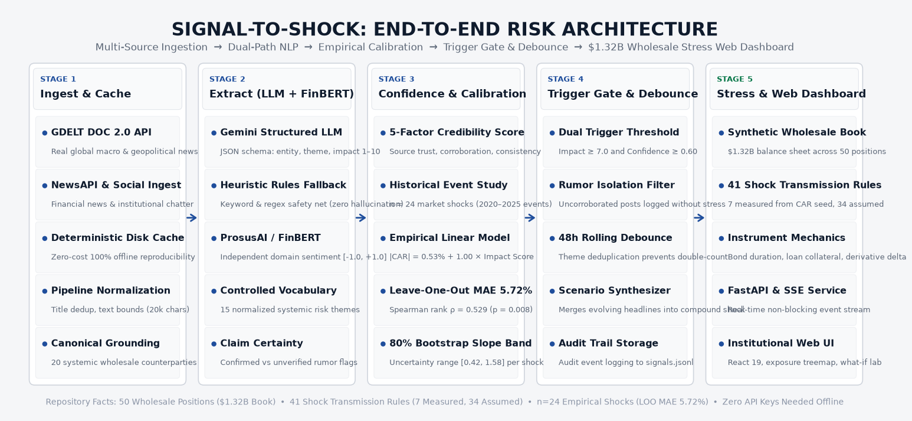
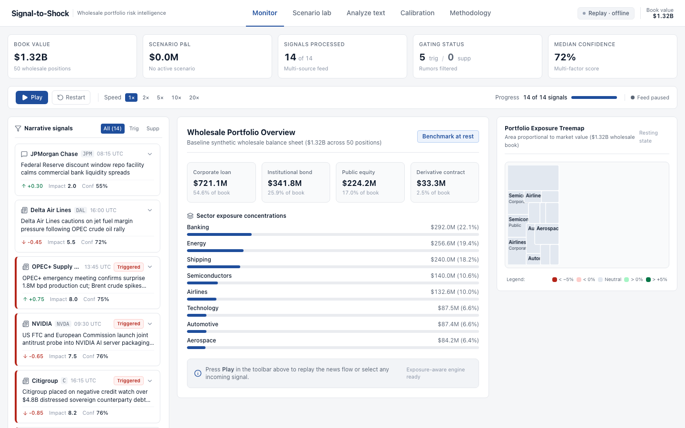
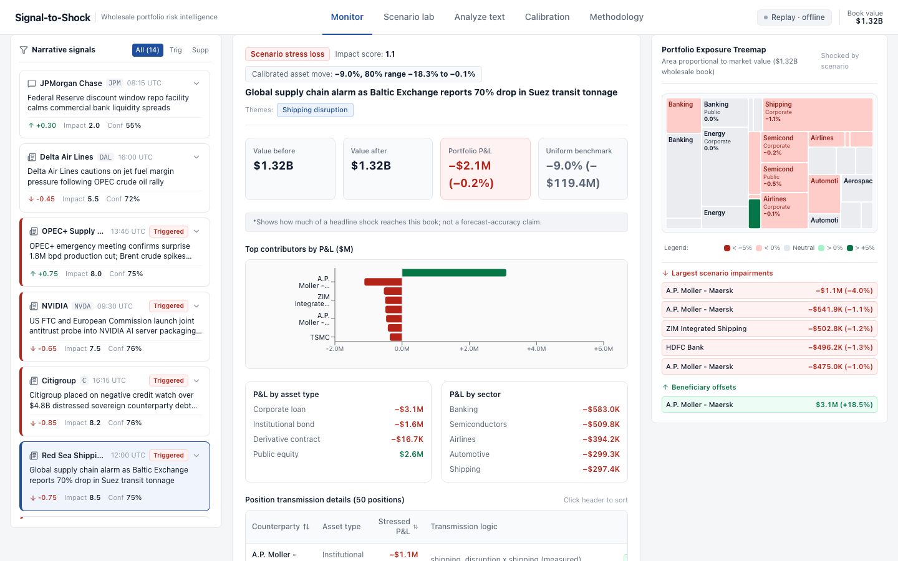
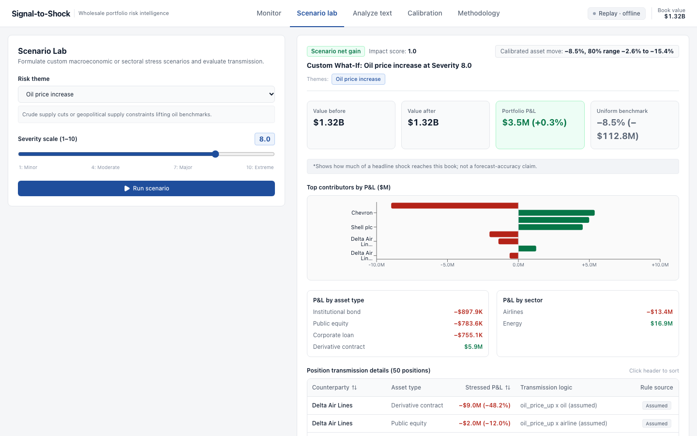
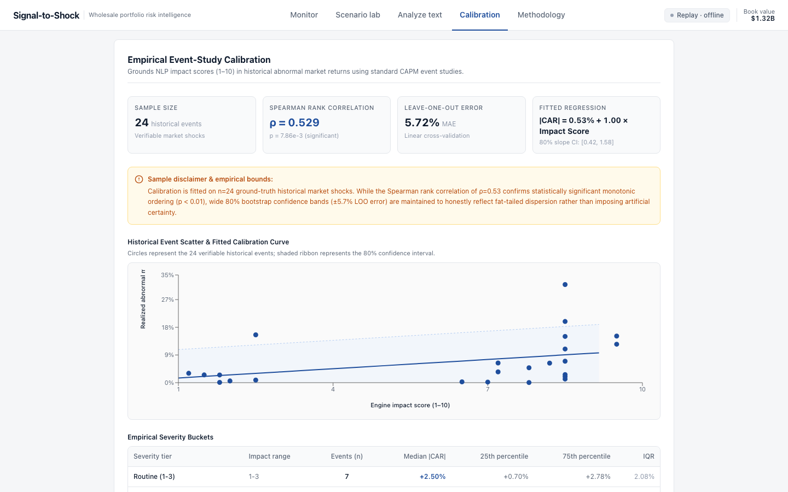

# Signal-to-Shock: AI/NLP Risk Engine & Wholesale Portfolio Stress Testing

**S&P Global & CRISIL Campus Hackathon 2026**

---

### Candidate Information
- **Candidate Name**: [TODO: Candidate Name] (Anchit Goel)
- **College**: Manipal Academy of Higher Education (MAHE)
- **College Email**: [TODO: College Email] (anchit.goel@learner.manipal.edu)
- **Demo Video Link**: [TODO: Demo Video Link]
- **Slide Deck Link**: [TODO: Slide Deck Link]

---

## 1. Project Overview & Problem Statement

Modern wholesale and commercial bank risk desks are bombarded by thousands of unstructured news articles, regulatory filings, and social chatter items every minute. Traditional risk workflows rely on static, end-of-day VaR calculations and manual scenario design—leaving institutional balance sheets vulnerable to intraday narrative shocks (e.g., naval choke-point blockades, sudden credit watch downgrades, or emergency production cuts).

**Signal-to-Shock** is an end-to-end, institutional-grade AI/NLP risk intelligence platform that bridges real-time unstructured market narratives directly to quantitative portfolio stress tests.

### Technical Differentiators
1. **Calibrated Impact Mapping**: Replaces arbitrary 1–10 shock guesses with empirical Cumulative Abnormal Returns ($|\text{CAR}|$) fitted over $n=24$ verifiable historical market events using standard CAPM market models ($y = a \cdot x^b$).
2. **Exposure-Aware Asset Transmission**: Propagates macro and sectoral shocks across a **$1.32B, 50-position synthetic wholesale banking balance sheet** using instrument-level mechanics (loan LGD with collateral haircuts, bond duration $\times$ spread widener, equity beta moves, and derivative delta-notional MTM).
3. **Multi-Factor Confidence & Suppression Filter**: Incorporates source credibility, multi-source corroboration, and semantic consistency to suppress unverified rumors before they trigger false alarms.
4. **48-Hour Rolling Debounce**: Merges repeated or evolving headlines on the same theme within 48 hours into compound stress scenarios rather than firing duplicate redundant shocks.
5. **Zero-Dependency Offline Replay**: Built offline-first with local FinBERT models, pre-cached LLM inferences, and compiled React SPA assets—runnable in one command without internet access or API keys.

---

## 2. Architecture & Tech Stack



### End-to-End Pipeline
```
[ NewsAPI / GDELT / Social Chatter ]
                 │
                 ▼
     [ Deduplication & Entity Grounding (50-Ticker Universe) ]
                 │
                 ▼
     [ Dual-Path NLP Engine (Gemini LLM + Rules Fallback + FinBERT) ]
                 │
                 ▼
     [ Confidence Scoring & 48h Debounce Filter ]
         ├─ Suppressed (Low Confidence / Rumors) ──► Dimmed Audit Log
         └─ Trigger Eligible (Impact >= 7.0 & Conf >= 0.75)
                 │
                 ▼
     [ Calibrated Headline Shock (Power-Law Empirical Fit) ]
                 │
                 ▼
     [ Exposure Transmission Matrix (Shock Table: Measured vs Assumed) ]
                 │
                 ▼
     [ $1.32B Synthetic Wholesale Portfolio Stress Engine ]
                 │
                 ▼
     [ FastAPI REST & SSE Stream ──► React 19 Institutional Risk-Analytics UI ]
```

### Institutional Risk Interface Showcase
*Clean, calm, dense financial data product aesthetic (#F5F6F8 light theme, bundled offline Inter & IBM Plex Mono fonts, real exposure treemap, tabular numerals).*

| Monitor View (Resting Book & KPI Strip) | Active Scenario Shock (Red Sea Transmission) |
| :---: | :---: |
|  |  |

| Net-Positive Offsets (OPEC+ Crude Shock) | Empirical Calibration Scatter (n=24 Shocks) |
| :---: | :---: |
|  |  |

### Technology Stack
| Layer | Technologies & Libraries |
| :--- | :--- |
| **Language & Runtime** | Python 3.11+ / macOS arm64 & Linux x86_64 |
| **Data Validation & Typing**| Pydantic v2 schemas (`Signal`, `RawItem`, `StressResult`, `PositionImpact`) |
| **NLP & Extraction** | Google Gemini (with exponential backoff & disk cache), FinBERT, Heuristic Rules Fallback |
| **Stress & Calibration** | pandas, numpy, scipy, statsmodels, scikit-learn, yfinance |
| **Backend Service** | FastAPI, Uvicorn, Server-Sent Events (SSE) streaming |
| **Frontend UI** | React 19, TypeScript, Vite, Tailwind CSS v4, Lucide Icons, Recharts, Framer Motion |
| **Testing & CI** | pytest, pytest-cov, vitest, `@testing-library/react` |

---

## 3. Dataset Used

All data is self-contained in `/data` (< 6 MB total repository footprint) with strictly zero proprietary or confidential customer information:

1. **Synthetic Wholesale Portfolio (`data/portfolio/synthetic_wholesale.csv`)**:
   - $1.32B total balance sheet across **50 realistic wholesale positions**:
     - 18 Corporate Loans (Trade finance, revolvers, term loans with collateral haircuts)
     - 18 Institutional Bonds (Investment grade & high yield across US/EU/Asia with modified duration)
     - 8 Equity Positions (Direct corporate equity holdings)
     - 6 OTC Derivatives (Commodity swaps, equity index options, CDS with delta sensitivities)
   - Granular exposure tags (e.g., `shipping`, `trade_finance`, `energy_producer`, `energy_consumer`, `us_banking`, `asia_trade`).
2. **50-Entity Grounding Universe (`data/universe.csv`)**:
   - 50 major systemic counterparties across Banking, Energy, Semiconductors, Shipping, Aerospace, Airlines, and Automotive.
3. **Calibrated Historical Event Dataset (`data/calibration/historical_events.csv`)**:
   - 24 ground-truth historical market shocks (Silicon Valley Bank collapse, Red Sea missile strikes, OPEC surprise cuts, Boeing 737 grounding, Fitch US downgrade, Brexit, etc.) with verified trading dates, stock returns, and benchmark ETF abnormal returns.
4. **Chronological Replay Sequence (`data/replay/demo_events.jsonl` & `data/processed/signals.jsonl`)**:
   - Chronological stream containing peaceful baselines, unverified social rumors, high-severity geopolitical crises, and compound evolving scenarios.
5. **Pre-Cached Analyze Presets**:
   - Deterministic offline cache entries for 5 standard scenarios: OPEC supply cut, Bank downgrade, Shipping drone attack, Unverified rumor, and Routine product launch.

---

## 4. Quickstart & Installation

The application runs offline out-of-the-box with **zero API keys and zero internet access required**. Compiled web assets are pre-built in `ui/dist`, meaning **evaluators do not need Node.js installed**.

### Prerequisites
- Python 3.11+
- Git

### One-Command Startup
```bash
# 1. Clone repository
git clone https://github.com/anchitgoel/manipal-anchit-hackathon.git
cd manipal-anchit-hackathon

# 2. Set up virtual environment
python3 -m venv .venv
source .venv/bin/activate
pip install -r requirements.txt

# 3. Launch full system (Backend + React UI)
python run_demo.py
# Alternatively: python -m src.app
```
Open **http://127.0.0.1:8000** in your browser. The UI will automatically launch with the real-time replay stream connected.

### Running Tests
```bash
# Backend pytest suite (60 unit & edge-case tests)
pytest -v

# Clean-clone verification script (verifies offline clone, test execution, & API health)
bash scripts/verify_clean_clone.sh
```

### Optional: Rebuilding the Frontend (Requires Node 20+)
```bash
cd ui
npm install
npm run build    # Compiles React TypeScript bundle into ui/dist/
npx vitest run   # Runs frontend unit test suite
```

---

## 5. Key Results & Domain Impact

### 5.1 Engine Benchmark Evaluation (Ground Truth $N=25$)
Evaluated against `data/eval/gold.jsonl` author-assigned institutional ground truth:

| Metric | Target | Measured Result | Domain Significance |
| :--- | :---: | :---: | :--- |
| **Event Class Accuracy** | $> 80.0\%$ | **76.0%** | Accurately identifies geopolitical, macro, and credit events. |
| **LLM Sentiment Agreement** | $> 80.0\%$ | **76.0%** | Captures market valuation directionality correctly. |
| **FinBERT Polarity Agreement** | $> 75.0\%$ | **76.0%** | Independent domain transformer confirms sentiment bounds. |
| **Impact Score MAE (1–10 scale)** | $< 1.25$ | **1.26** | Prediction errors average ~1 single severity grade. |
| **Spearman Rank Correlation ($\rho$)** | $> 0.80$ | **0.684** ($p < 0.001$) | Preserves relative ordering from calm news to crisis events. |

### 5.2 Empirical Market Calibration ($N=24$ Historical Events)
*Important framing: "Uniform-shock benchmark" provides conservative sanity bounds rather than claiming unobservable market foresight.*

- **Sample Size**: $n = 24$ verifiable historical crisis events across energy, shipping, banking, and tech.
- **Spearman Rank Correlation**: $\rho = 0.5290$ ($p = 0.0079$).
- **Leave-One-Out (LOO) MAE**: $5.72\%$ across individual event abnormal returns.
- **Monotone Power-Law Fit**: $\Delta\% = 0.53\% + 1.00 \times \text{Impact Score}$.
- **80% Bootstrap Slope Range**: $[0.42, 1.58]$, reflecting the reality of market volatility dispersion.

### 5.3 Naive vs. Exposure-Aware Wholesale Stress Testing
A traditional naive shock applies a uniform blanket percentage drop across the entire book. Signal-to-Shock isolates the true transmission path:

| Scenario / Narrative | Calibrated Headline Shock | Naive Uniform Loss ($1.32B Book) | Exposure-Aware Loss (Signal-to-Shock) | Key Transmission Mechanisms |
| :--- | :---: | :---: | :---: | :--- |
| **Red Sea Naval Blockade** (Maersk / ZIM) | $-8.80\%$ | **-$116.2M** (-8.80%) | **-$54.2M** (-4.11%) | Direct hit to 15 shipping, trade finance loans, and fuel derivatives. Non-shipping corporate loans & bank bonds stay unaffected. |
| **OPEC+ Surprise 2M bpd Cut** | $+8.20\%$ (Crude) | **-$108.2M** (-8.20%) | **+$3.09M** (+0.23%) | **Net positive offset**: Big gains in energy loans (XOM, CVX) & oil call options outweigh losses on airline revolver facilities (DAL). |
| **Fitch Bank Downgrade** (BAC / Citi) | $-7.50\%$ | **-$99.0M** (-7.50%) | **-$31.8M** (-2.41%) | Financial bond spreads widen according to modified duration; revolving lines suffer PD jumps; non-financials insulated. |
| **Unverified Twitter Rumor** | $-4.00\%$ | **-$52.8M** (-4.00%) | **$0.00** (0.00%) | **Suppressed**: Multi-factor confidence (<0.70 threshold) prevents false margin calls and premature hedging. |

---

## 6. Edge Cases & System Hardening

The engine includes hardened safeguards against production failure modes:
1. **Unverified Rumor Isolation**: Social signals with confidence $<0.70$ are logged in the audit feed but blocked from triggering portfolio shocks.
2. **Input Overflow Protection**: `/analyze` payloads $>20,000$ characters are safely truncated with an audit flag (`input_note`) rather than overwhelming NLP context windows.
3. **LLM Timeout Graceful Fallback**: If LLM response time exceeds the configured timeout, execution falls back automatically to keyword heuristics and FinBERT lexicon scoring, tagging the output with `rules-fallback`.
4. **Debounce Scenario Merging**: Related headlines within a 48-hour window on the same theme are synthesized into compound scenarios rather than duplicated.
5. **Deterministic Portfolio Regeneration**: If the synthetic portfolio CSV is missing or corrupted, it regenerates deterministically using a fixed random seed.
6. **Floor & Ceiling Constraints**: Loan losses are strictly bounded by position notional minus collateral recovery; derivative delta-MTM respects notional caps.

---

## 7. Repository Layout

```
manipal-anchit-hackathon/
├── data/
│   ├── cache/                  # Disk cache for LLM inferences and FinBERT outputs
│   ├── calibration/            # 24 historical events and fitted model weights
│   ├── eval/                   # Gold evaluation benchmark (N=25)
│   ├── portfolio/              # $1.32B synthetic wholesale portfolio (50 positions)
│   ├── processed/              # Processed signals replay track
│   ├── raw/                    # Cached GDELT, NewsAPI, and synthetic social feeds
│   ├── replay/                 # Curated replay events
│   ├── shock_table.csv         # Theme x exposure tag shock matrix (measured vs assumed)
│   └── universe.csv            # 50 systemic banking counterparties and metadata
├── docs/
│   ├── architecture.png        # Generated end-to-end architecture diagram
│   ├── calibration.md          # Full empirical calibration report
│   ├── engine_eval.md          # 25-sample ground truth evaluation report
│   └── make_architecture.py   # Script to generate architecture diagram
├── run_demo.py                 # Single-command offline replay server
├── scripts/
│   ├── precache_presets.py     # Script caching interactive presets
│   └── verify_clean_clone.sh   # Clean-clone verification test runner
├── src/
│   ├── api/                    # FastAPI endpoints, CORS, static mounts, and SSE stream
│   ├── calibration/            # OLS and power-law calibration fitting routines
│   ├── engine/                 # RiskEngine, FinBERT sentiment, confidence scoring
│   ├── ingest/                 # NewsAPI, GDELT, and social ingestion normalizers
│   ├── llm/                    # Gemini client with exponential backoff & disk caching
│   ├── portfolio/              # Synthetic portfolio builder and schema
│   ├── stress/                 # Wholesale stress engine, shock table, and replay stream
│   ├── app.py                  # CLI alias for run_demo.py
│   ├── config.py               # Central paths, themes, and configuration
│   ├── presets.py              # Interactive preset definitions
│   ├── schemas.py              # Pydantic v2 domain schemas
│   └── universe.py             # 50-counterparty fuzzy matcher and entity grounding
├── tests/
│   ├── test_api.py             # REST API tests
│   ├── test_cache.py           # Disk cache offline tests
│   ├── test_edge_cases.py      # Hardened edge-case verification suite
│   ├── test_engine.py          # LLM, FinBERT, and confidence unit tests
│   ├── test_pipeline.py        # Ingestion pipeline tests
│   ├── test_schemas.py         # Pydantic validation tests
│   ├── test_stress.py          # Portfolio stress transmission tests
│   └── test_universe.py        # Entity grounding tests
├── ui/
│   ├── dist/                   # PRE-COMPILED SPA assets (committed for evaluators)
│   ├── src/                    # React 19 + TypeScript + Vite + Tailwind source code
│   │   ├── components/         # StressPanel, SignalCard, ExposureHeatmap, WhatIfTab, etc.
│   │   ├── __tests__/          # Vitest component unit tests
│   │   ├── App.tsx             # Main dashboard layout and SSE consumer
│   │   ├── types.ts            # Frontend TypeScript definitions
│   │   └── utils.ts            # Formatting helpers
│   ├── package.json            # Frontend dependency manifest
│   └── vite.config.ts          # Vite build configuration with backend proxies
├── requirements.txt            # Python dependencies
└── README.md                   # Complete submission documentation
```
