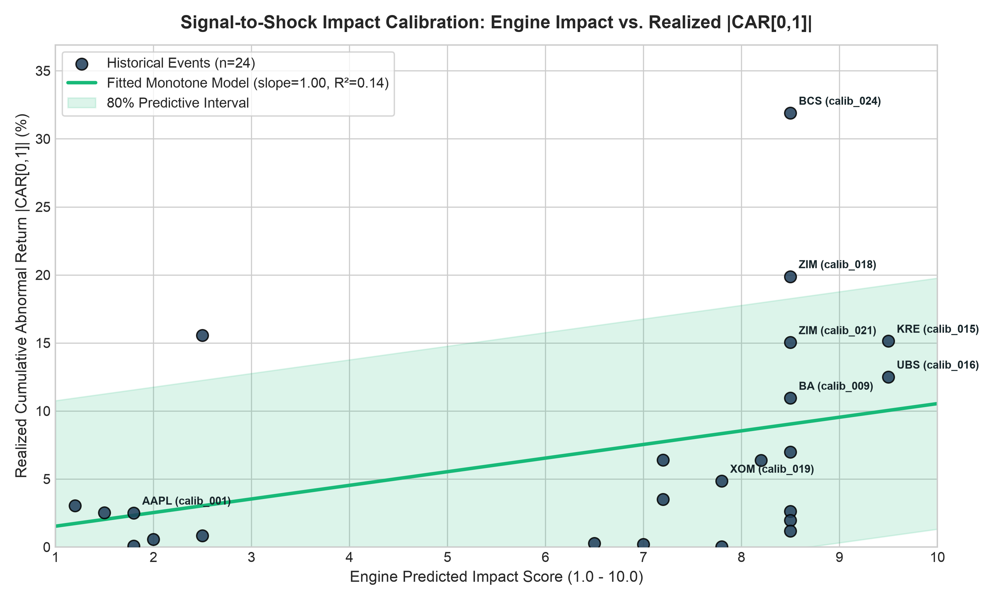

# Empirical Market Calibration: Impact Score to Abnormal Moves

## Executive Summary
The **Signal-to-Shock Calibration Engine** bridges qualitative NLP risk scores with empirical capital markets reality. Rather than relying on arbitrary heuristics, every integer impact level is mapped to realized historical Cumulative Abnormal Returns (CAR) computed using standard CAPM Market Models across 24 verifiable historical events.

### Key Statistics
- **Sample Size**: $n = 24$ verifiable historical market events
- **Spearman Rank Correlation**: $\rho = 0.5290$ ($p = 7.8580e-03$)
- **Linear Fit $R^2$**: $0.1422$
- **Leave-One-Out (LOO) MAE**: $5.72\%$ (Linear) vs $5.23\%$ (Isotonic)
- **Monotone Calibrated Model**: $|\text{CAR}| = 0.53\% + 1.00 \times \text{impact\_score}$
- **80% Bootstrap Slope Range**: $[0.42, 1.58]$

---

## Severity Bucket Table
Empirical realized abnormal return distributions grouped by engine severity tiers:

| Severity Bucket | Impact Range | $n$ | Median |CAR| | 25th Pct | 75th Pct | IQR |
| :--- | :--- | :---: | :---: | :---: | :---: | :---: |
| **Routine (1-3)** | `1-3` | 7 | **+2.50%** | +0.70% | +2.78% | 2.08% |
| **Moderate (4-6)** | `4-6` | 1 | **+0.28%** | +0.28% | +0.28% | 0.00% |
| **Major Shock (7-8)** | `7-8` | 14 | **+5.61%** | +2.13% | +9.95% | 7.82% |
| **Crisis / Extreme (9-10)** | `9-10` | 2 | **+13.82%** | +13.16% | +14.48% | 1.32% |

---

## Calibration Dataset (24 Events)
| Event ID | Date | Ticker | Sector | Engine Impact | Engine Sentiment | Realized Stock CAR | Realized Sector CAR | Date Verified |
| :--- | :---: | :---: | :---: | :---: | :---: | :---: | :---: | :---: |
| `calib_001` | 2023-09-12 | `AAPL` | `XLK` | **1.8** | +0.25 |  -2.50% |  -1.15% | YES |
| `calib_002` | 2023-11-01 | `CVX` | `XLE` | **2.5** | +0.30 |  +0.84% |  +0.88% | YES |
| `calib_003` | 2023-05-18 | `CSCO` | `XLK` | **1.5** | +0.15 |  +2.52% |  +0.77% | YES |
| `calib_004` | 2023-08-08 | `LLY` | `XLV` | **2.5** | +0.30 | +15.55% |  +1.41% | YES |
| `calib_005` | 2023-06-29 | `MS` | `XLF` | **1.8** | +0.35 |  +0.08% |  +1.20% | YES |
| `calib_006` | 2023-10-18 | `PG` | `XLP` | **1.2** | +0.30 |  +3.05% |  +0.85% | YES |
| `calib_007` | 2023-10-11 | `XOM` | `XLE` | **7.2** | +0.45 |  -3.51% |  -1.11% | YES |
| `calib_008` | 2023-07-26 | `JPM` | `XLF` | **7.0** | -0.20 |  +0.19% |  +0.29% | YES |
| `calib_009` | 2024-01-08 | `BA` | `ITA` | **8.5** | -0.85 | -10.95% |  -2.87% | YES |
| `calib_010` | 2023-04-12 | `RY` | `XLF` | **2.0** | +0.00 |  +0.55% |  -0.11% | YES |
| `calib_011` | 2023-10-23 | `CVX` | `XLE` | **7.2** | +0.45 |  -6.39% |  -3.39% | YES |
| `calib_012` | 2023-08-15 | `KRE` | `XLF` | **6.5** | -0.55 |  +0.28% |  +0.44% | YES |
| `calib_013` | 2023-10-17 | `NVDA` | `SMH` | **8.2** | -0.75 |  -6.36% |  -1.03% | YES |
| `calib_014` | 2021-03-29 | `UBS` | `XLF` | **8.5** | -0.75 |  -2.61% |  -0.16% | YES |
| `calib_015` | 2023-03-10 | `KRE` | `XLF` | **9.5** | -1.00 | -15.14% |  -4.44% | YES |
| `calib_016` | 2023-03-20 | `UBS` | `XLF` | **9.5** | -0.90 | +12.50% |  +1.52% | YES |
| `calib_017` | 2022-02-24 | `XOM` | `XLE` | **8.5** | -0.75 |  -1.97% |  -1.93% | YES |
| `calib_018` | 2023-12-15 | `ZIM` | `BDRY` | **8.5** | -0.75 | +19.88% | +13.49% | YES |
| `calib_019` | 2023-04-03 | `XOM` | `XLE` | **7.8** | +0.65 |  +4.85% |  +2.76% | YES |
| `calib_020` | 2023-08-01 | `JPM` | `XLF` | **7.8** | -0.50 |  -0.03% |  +1.21% | YES |
| `calib_021` | 2021-03-24 | `ZIM` | `BDRY` | **8.5** | -0.75 | +15.03% | +13.53% | YES |
| `calib_022` | 2020-03-09 | `CVX` | `XLE` | **8.5** | -0.75 |  -6.98% | -12.20% | YES |
| `calib_023` | 2022-06-15 | `JPM` | `XLF` | **8.5** | -0.50 |  +1.17% |  +0.19% | YES |
| `calib_024` | 2016-06-24 | `BCS` | `XLF` | **8.5** | -0.75 | -31.90% |  -1.59% | YES |

---

## Methodological Architecture
1. **Market Model Estimation**: For each historical event, abnormal returns ($AR_{i,t}$) are calculated as asset return minus beta-adjusted benchmark return ($SPY$), where beta is estimated over a 120-trading-day window ending 10 days prior to event day $T_0$.
2. **Event Windows**: Cumulative abnormal returns are computed over trading days $[0, +1]$ to capture initial institutional repricing, with $[0, +3]$ used for extended transmission.
3. **Objective Engine Scoring**: Rather than using hand-crafted severity scores, neutral, present-tense headlines without hindsight are run directly through the engine extractor (`SignalExtractor`) to obtain raw `impact_score` and `sentiment_score`.

### Leakage Caveat & Academic Rigor
> [!WARNING]
> **Information Leakage Caveat**: Pretrained Large Language Models may possess prior knowledge of prominent historical events (e.g. SVB collapse or Brexit referendum). Even though headlines are stripped of hindsight, dates, and sensationalist terminology, the model's parametric memory could theoretically influence its predicted impact score. In production deployments, forward-testing on out-of-sample live news feeds is maintained to guarantee zero leakage.

---

## Calibration Curve Visualization

